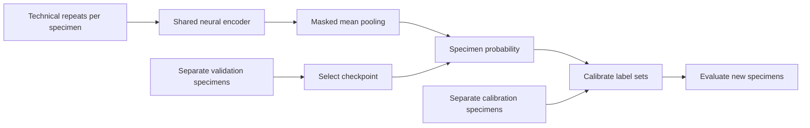

# ReplicateShift

**More independent specimens, or more technical repeats?**

[](https://github.com/Chencharl/replicateshift/actions/workflows/tests.yml)

ReplicateShift is a research toolkit for learning from repeated assays and evaluating specimen-level predictive uncertainty. It combines a **Deep Sets neural network**, statistical baselines, and split conformal prediction to study how measurement allocation changes prediction quality under a fixed assay budget.

**v0.2 is executable software with an executed experiment:** fit a model from a CSV, save it, predict label sets for new specimens, or reproduce the 180-run allocation pilot. The public data are entirely synthetic. The motivating setting is RNA/omics research with technical replicates; the simulator does not model RNA chemistry or instrument physics.

## The project in one view



The research question is concrete: **under a budget of 600 development measurements, what changes when we measure 600 specimens once, 200 specimens three times, or 100 specimens six times?** Every policy gets its own training, validation, and calibration specimens. Its 300 external test specimens have the same repeat count as development; their additional measurement cost is reported separately.

| Repeats per specimen | Training | Validation | Calibration | Development assays | Additional test assays |
|---:|---:|---:|---:|---:|---:|
| 1 | 360 | 120 | 120 | 600 | 300 |
| 3 | 120 | 40 | 40 | 600 | 900 |
| 6 | 60 | 20 | 20 | 600 | 1,800 |

## Executed results

Ten independent complete-run seeds × two noise levels × three allocations × three models = **180 model-condition runs and 54,000 test predictions**. The configuration was fixed before inspecting these results. Values below are mean Brier scores ± Monte Carlo SE across runs; lower is better.

| Noise SD | Repeats | Mean + interactions | Mean + SD + interactions | Deep Sets |
|---:|---:|---:|---:|---:|
| 0.35 | 1 | 0.226 ± 0.008 | 0.226 ± 0.007 | 0.230 ± 0.005 |
| 0.35 | 3 | 0.247 ± 0.002 | 0.246 ± 0.001 | 0.248 ± 0.005 |
| 0.35 | 6 | 0.255 ± 0.008 | 0.252 ± 0.004 | 0.256 ± 0.006 |
| 1.00 | 1 | 0.252 ± 0.003 | 0.252 ± 0.004 | 0.247 ± 0.002 |
| 1.00 | 3 | 0.250 ± 0.002 | 0.248 ± 0.001 | 0.250 ± 0.005 |
| 1.00 | 6 | 0.250 ± 0.003 | 0.252 ± 0.004 | 0.262 ± 0.008 |

In this pilot, spending the development budget on more specimens was associated with better neural-model Brier scores at both noise levels. Deep Sets had no consistent advantage over the statistical baselines. Its mean conformal coverage ranged from 0.883 to 0.909, with mean set sizes from 1.662 to 1.785 out of two possible labels. Coverage near 90% can coexist with weak label discrimination.

These are exploratory simulation findings. Ten runs do not establish a universal allocation rule or a precise coverage audit. Repeats change both training and test-time information, and the budget excludes specimen procurement, preparation, failed assays, and computing cost.

Read the [full results and paired comparisons](results/allocation_v0.2/REPORT.md), [raw metrics](results/allocation_v0.2/per_run_metrics.csv), and [provenance manifest](results/allocation_v0.2/manifest.json). Download or clone the repository and open [report.html](results/allocation_v0.2/report.html) for a self-contained filterable results table; GitHub displays its source.

## Use the toolkit

Requires Python 3.10+ and NumPy. No downloaded model, GPU, external dataset, or running service is needed. In an environment where installation is permitted:

```sh
git clone https://github.com/Chencharl/replicateshift.git
cd replicateshift
python -m pip install -e .

# Fit, select a checkpoint, calibrate, and evaluate untouched holdout specimens.
replicateshift fit examples/synthetic_assay.csv --output results/local-model

# Reuse the frozen model and calibration on new specimen IDs.
replicateshift predict --model results/local-model \
  --input examples/new_specimens.csv --output results/local-predictions.csv

# Reproduce the frozen allocation experiment.
replicateshift-allocation --config configs/allocation_pilot.json \
  --output results/local-allocation

python -m unittest discover -s tests -v
```

With an existing NumPy environment, prefix commands with `PYTHONPATH=src` and use `python -m replicateshift.toolkit` or `python -m replicateshift.allocation`; installation is optional. All outputs require fresh paths.

The [included example](examples/README.md) contains actual input CSVs, a fitted JSON/NPZ model bundle, holdout results, and predictions for 30 new synthetic specimens. You can run `predict` directly against `examples/fitted_model`.

### CSV contract

```csv
specimen_id,replicate_id,label,feature_signal,feature_background
sample_001,r1,0,1.2,0.4
sample_001,r2,0,1.3,0.5
sample_002,r1,1,2.1,0.3
```

The snippet illustrates the schema; fitting requires at least 60 specimens. Each specimen has one binary label and one or more technical repeats. Labels must agree within specimens. Numeric `feature_*` columns must be finite and complete. Repeat counts may vary. Prediction accepts the same feature names in any order, with labels optional. Previously used specimen IDs are rejected, but new identifiers alone cannot establish independence.

The CSV workflow allocates complete specimens to **50% fitting, 15% checkpoint selection, 15% calibration, and 20% holdout**. This differs deliberately from the allocation experiment's 60/20/20 development split plus external test pool. No patient, family, or shared random-batch hierarchy is supported. Use requires independent specimens and exchangeability of calibration and future whole-specimen objects, including their repeat-collection policy.

## What is implemented

- **A learned repeat-set representation:** shared `d → 16 → 12` tanh encoder, masked mean pooling, and `12 → 12 → 1` tanh/sigmoid head. Explicit backpropagation, full-batch Adam, specimen-weighted loss, and training-only scaling run in NumPy.
- **Strong simple comparators:** logistic regression on specimen means with every pairwise interaction, and the same feature map plus within-specimen SD. All models choose a validation-BCE checkpoint from 120 fixed epochs.
- **Predictive inference:** one conformal score per independent specimen; exact finite-sample order statistic, conservative ties, and coverage reported alongside set size and empty/singleton rates.
- **Reusable artifacts:** strict CSV ingestion, JSON metadata, non-pickle NPZ weights, input/weight checksums, recorded split IDs, and frozen calibration reused at prediction time.
- **Auditable experiments:** separate role pools and random streams, paired policy comparisons, per-run results, Monte Carlo SE, compressed raw predictions, source/output hashes, and runtime scope.
- **Verification:** numerical gradient checks, repeat-order/padding invariance, checkpoint replay, leakage guards, state roundtrip, end-to-end artifact reconstruction, and GitHub Actions. See the [validation record](docs/VALIDATION.md) and [independent implementation review](docs/V0_2_REVIEW.md).

Mean pooling ignores the total repeat count: duplicating an entire set leaves its score unchanged. Variable-count ingestion does not imply that the model learns uncertainty from cardinality. The Gaussian-noise simulator also makes SD largely ancillary; it is not designed to ensure a neural-model win.

## Statistical scope and contribution

The target is a **binary label for a new specimen**. Under exchangeable calibration and test specimens and an independently fitted score, split conformal prediction gives marginal coverage. It does not establish conditional coverage for every subgroup, calibrated class probabilities, a biological-effect confidence interval, or causal identification. Arbitrary distribution shift can break the guarantee.

The project's contribution is an inspectable toolkit and measurement-allocation experiment. Deep Sets and split conformal prediction are established methods; a new statistical theorem or real-data advantage is not claimed. The [v0.1 snapshot](results/smoke_v0.1/REPORT.md) additionally retains a measurement-shift stress test and permuted-label leakage control; its [historical methods](docs/METHODS_V0_1.md) are separate from the [current methods](docs/METHODS.md).

Project owner: **Chen Yang**. Implementation and review developed with AI assistance. Source, tests, exact protocols, and negative results are public so the work can be inspected and extended.

## References

- Zaheer et al. [Deep Sets](https://arxiv.org/abs/1703.06114).
- Angelopoulos & Bates. [A Gentle Introduction to Conformal Prediction and Distribution-Free Uncertainty Quantification](https://arxiv.org/abs/2107.07511).
- Dunn, Wasserman & Ramdas. [Distribution-Free Prediction Sets for Two-Layer Hierarchical Models](https://arxiv.org/abs/1809.07441). Related hierarchical inference; this project calibrates whole-specimen labels and does not implement their hierarchical procedures.

MIT license. Cite the software using [CITATION.cff](CITATION.cff), and cite the underlying methods separately.
